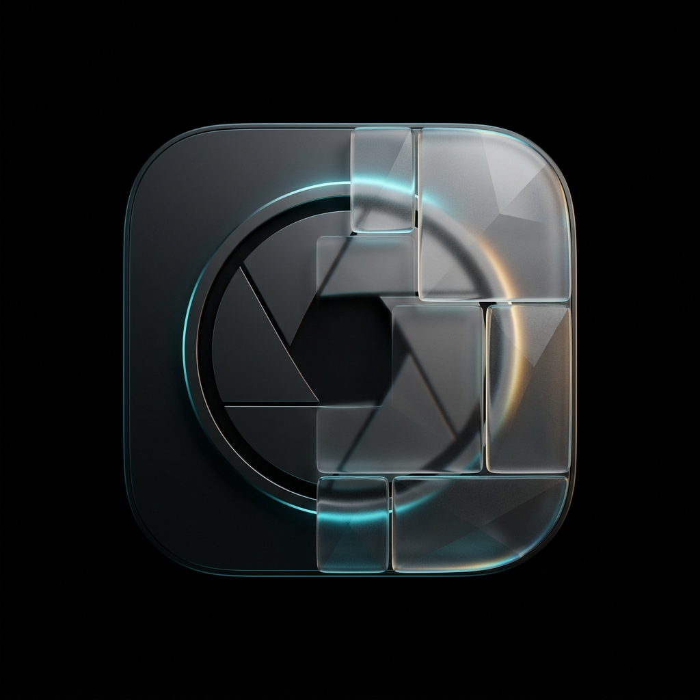

# ✦ Hanny Montany

<div align="center">



### **Privacy Censor & Photo Studio**
*Zero-Leak In-Memory Photo Editor, Creative Privacy Censorship & Progressive Web App*

[](#privacy--threat-model)
[](#privacy--threat-model)
[](#zero-leak-metadata-scrubbing)
[](#zero-build-architecture)
[](LICENSE)

**`v2.5.0 • made by FlashSolver for Hanim 🫶`**

</div>

---

## 📖 Overview

**Hanny Montany** is a modern, zero-dependency, privacy-first photo censor and creative studio engineered as an offline Progressive Web App (PWA).

Inspired by the touch ergonomics and aesthetic filter fidelity of premium iOS photography apps, it combines dual-layer alpha mask rendering with 20 real-time visual filters, textured artistic brushes, transparent disguise stickers, and on-device computer vision redaction.

### 🛡️ Why Hanny Montany?
* **Zero Cloud Uploads**: Photos never leave your device. All image manipulation happens inside your browser's transient RAM.
* **Zero Storage Footprint**: No cookies, no `localStorage`, no `sessionStorage`, and no `IndexedDB`. Closing the tab permanently vaporizes all image data.
* **Guaranteed EXIF & GPS Eradication**: Smartphone photos contain sensitive geolocation, camera serial numbers, and timestamps. Hanny Montany re-encodes pixel streams through a fresh Canvas bitmap upon export, permanently stripping all metadata.
* **Runs Anywhere Without a Server**: Built for Chromebooks, iPhones, iPads, Android devices, and desktops. Open the link once, install to your home screen or shelf, and use it offline forever.

---

## ✨ Features at a Glance

### 🎨 4 Studio Modes

| Mode | Capability | Key Tools |
| :--- | :--- | :--- |
| **Blur & Mosaic** | Dual-layer alpha masking over 20 visual shaders with 60 FPS brush rendering. | Freehand brush, Rectangle & Oval shapes, Invert mask (spotlight), 5 stroke textures. |
| **Artistic** | Textured physical media simulation for tactile, stylish redaction. | Harmonized Multi-Tone skin swatches, Chalk/Pastel, Oil Palette Knife, Crayon Wax, Glitter Sparkles, Splatter Spray. |
| **Stickers** | 18 transparent disguise and privacy vector stamps. | Groucho Marx glasses, Thug Life shades, Bows, Mustache, Cat face, CENSORED bars, Emojis, 360° rotate, scale & opacity. |
| **Auto Detect** | 100% client-side computer vision with interactive bounding box previews. | Auto Face Censor, Text & ID Document Redaction, Portrait Bokeh (depth blur), Object Erase inpainting. |

---

### 🔬 20 Visual Privacy & Aesthetic Filters

1. **Natural Blur**: Multi-pass box filter approximating smooth optical Gaussian blur.
2. **Heavy Bokeh**: Deep cinematic focal blur for dramatic background isolation.
3. **Square Mosaic**: Classic block pixelation with continuous resolution scaling.
4. **Hex Mosaic**: Geometric honeycomb hexagonal cell quantization.
5. **Reeded Glass**: Vertical fluted privacy glass simulation with caustics and refraction.
6. **Frosted Glass**: Translucent textured shower-glass dispersion.
7. **Solid Blackout**: Flat legal document redaction with color selection.
8. **Face Cloak**: Adversarial high-frequency perturbation that defeats biometric facial recognition scrapers without disfiguring human vision.
9. **Brush Stroke**: Painterly directional motion smear with bristle striation LUT and angle control (`0°`, `45°`, `90°`, `135°`).
10. **Motion Blur**: High-speed directional horizontal streak blur.
11. **Radial Zoom**: Dynamic explosive burst blur radiating from focal centers.
12. **Chromatic Prism**: Prismatic red/blue channel split along optical dispersion axes.
13. **Cyberpunk Glitch**: RGB channel displacement, scanline jitter, and artifact slicing.
14. **ASCII Matrix**: Phosphor green luminance-to-character terminal matrix.
15. **Liquid Swirl**: Organic hydrodynamic marble swirl distortion.
16. **Halftone Dots**: Retro comic book monochrome dot screen.
17. **Pop Art Screenprint**: 4-tier Warhol posterization with vibrant ink quantization.
18. **Color Split**: Vintage CMYK offset press plate misregistration.
19. **Thermal Heatmap**: 256-level false-color infrared spectrum.
20. **Duotone Risograph**: Editorial two-tone gradient mapping.

---

### 🛠️ Precision UX & Mobile Ergonomics

* **Floating Precision Loupe**: A $2.5\times$ magnified contact lens reticle hovers $80\text{px}$ above your finger so fine details and text lines are never blocked by touch contact.
* **Hold-to-Compare**: Hold the HUD **Original** button or press <kbd>Spacebar</kbd> for instant zero-latency before/after comparison.
* **Shape Masks**: One-tap toggling between **Freehand Brush**, **Rectangle (Box)**, and **Oval (Circle)** geometric censoring.
* **Invert Mask (Focal Spotlight)**: Invert masks with 1 click to keep subjects crystal sharp while artistically blurring everything else.
* **Stacked Precision Sliders**: Full-width slider rows with one-tap numeric jump pills (`16/45/90px`, `25/65/100%`).
* **Interactive Export Modal**: Export directly to **PNG (Lossless)**, **JPEG (Photo)**, or **WebP (Modern)** with real-time compression quality sliders.

---

## 🌐 1-Click Hosting on GitHub Pages

Because Hanny Montany has zero dependencies and requires no compilation, it hosts instantly on **GitHub Pages**:

1. In your GitHub repository, navigate to **Settings** $\rightarrow$ **Pages**.
2. Under **Build and deployment** $\rightarrow$ **Branch**, select `main` and root `/`.
3. Click **Save**.
4. Within 60 seconds, your personal studio is live at:
   ```
   https://<your-username>.github.io/<your-repo-name>/
   ```

---

## 📱 PWA Installation (Offline On-Device)

* **Chromebooks & Desktops (Chrome / Edge / Brave)**:
  Click the **Install** icon in the right side of the URL bar (or Menu $\rightarrow$ *Install Hanny Montany*). The app pins to your desktop or ChromeOS shelf and works with zero internet.
* **iPhone & iPad (Safari)**:
  Tap the **Share** button $\rightarrow$ select **"Add to Home Screen"**. Launches full-screen without Safari browser address bars.
* **Android (Chrome)**:
  Tap the three dots menu $\rightarrow$ **"Install App"** (or *Add to Home screen*).

---

## 💻 Local Developer Server (Optional)

If you wish to run or test locally on your computer:

```bash
# Clone the repository
git clone https://github.com/<your-username>/Hanny-Montany.git
cd Hanny-Montany

# Start the zero-dependency hardened static server
node server.mjs
```

Then open **`http://localhost:3000`** in any modern web browser.

---

## 🔒 Privacy & Threat Model

* **Content Security Policy (CSP)**: Hardened with strict `default-src 'self'; connect-src 'self'; object-src 'none'; form-action 'none'`. External network exfiltration is mathematically blocked by the browser engine.
* **Memory Confinement**: Images exist exclusively as transient pixel buffers in JavaScript heap memory. Closing the browser tab destroys all buffers permanently.
* **Zero Trackers**: Zero Google Analytics, zero telemetry SDKs, zero third-party CDNs, zero social tracking pixels.

---

## 📄 License & Dedication

Distributed under the **MIT License**.

Crafted with dedication:  
**`v2.5.0 • made by FlashSolver for Hanim 🫶`**
